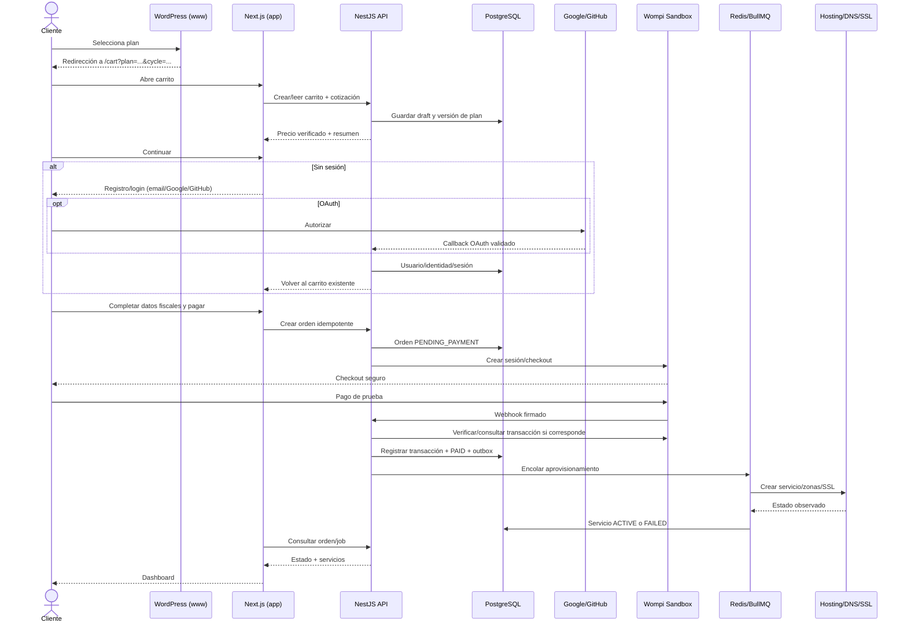

# Velupi Cloud — UC-NEW-001: Compra de plan por nuevo cliente

**Versión:** 1.0 · **Fecha:** 2026-10-15 · **Estado:** Especificación funcional para implementación

## Objetivo y alcance

Un visitante llega a **https://www.velupi.com** (WordPress alojado en HestiaCP), selecciona un plan, revisa su carrito en **https://app.velupi.com**, se registra o inicia sesión (correo, Google o GitHub), indica sus datos de facturación, paga por **Wompi** y consulta el aprovisionamiento de su servicio en el dashboard. WordPress solo exhibe planes y redirige: **no maneja contraseñas, órdenes, pagos ni provisión**. HestiaCP, Docker y Traefik son proveedores internos invisibles al cliente.

Las capturas de Hostinger son **referencias de estructura y experiencia**, no una instrucción de copiar su marca o procesador: carrito, registro y pago secuenciales.

## Actores y sistemas

- Visitante / cliente nuevo; cliente existente; operador Velupi.
- WordPress comercial: `www.velupi.com` (con redirección canónica coherente con `velupi.com`).
- Portal: `app.velupi.com` (Next.js 15 + MUI); API: `api.velupi.com` (NestJS); PostgreSQL/Prisma; Redis/BullMQ; Wompi Sandbox; adaptadores Hosting y DNS.

## Flujo principal

1. WordPress obtiene planes publicados y sus códigos/URLs comerciales desde el catálogo de la API (lectura), o usa enlaces administrados y versionados. CTA: `https://app.velupi.com/cart?plan=wp-starter&cycle=ANNUAL`. La API **no acepta un precio del navegador**.
2. El portal valida `plan` y `cycle` en el backend y crea/recupera un **carrito temporal** con ID aleatorio opaco y caducidad. Muestra nombre del plan, período, precio, descuento, renovación, impuestos estimados, características, extras opcionales y total. Debe aclarar condiciones de renovación y vigencia de promociones.
3. El visitante pulsa **Continuar**. Si no está autenticado, se dirige a `app.velupi.com/register?returnTo=<ruta-interna-validada>`, ofreciendo registro por email + contraseña, **Continuar con Google**, **Continuar con GitHub**, y enlace **Iniciar sesión**. Mantener ID de carrito sin confiar en URLs arbitrarias de retorno.
4. Registro email: se crea usuario con Argon2id, se verifica el correo por enlace de uso único y se crea o elige su organización. OAuth: flujo Authorization Code + PKCE, validación de `state` y `nonce` cuando aplique, usuario identificado por `issuer + sub`/provider ID; vinculación de identidades existentes **solo tras prueba de titularidad**. El email no basta para fusionar cuentas. Se conserva carrito durante redirects y errores.
5. Al completar autenticación/verificación, el usuario retorna a su **mismo carrito**; se asocia al usuario/organización y pasa a `checkout`.
6. Checkout: resumen inmutable del pedido, país y datos de facturación obligatorios según el caso (persona/empresa, nombre, documento fiscal cuando corresponda, dirección, email); opción de cupón si existe; selección de método disponible en Wompi para país/moneda. No pedir ni almacenar tarjeta/CVV directamente en Velupi: **redirigir a checkout alojado por Wompi o usar componente de tokenización oficial**.
7. Backend genera el pedido `PENDING_PAYMENT` idempotente con `planVersionId`, `cycle`, líneas, moneda y precio final calculado en servidor, y la sesión/referencia de pago de Wompi. El frontend inicia el pago mediante integración del proveedor. No aprovisionar con un simple `return_url` del navegador.
8. El proveedor notifica vía webhook: validación de firma según especificación oficial, correlación de transacción/orden, consulta del estado en proveedor cuando sea necesaria, prevención de replay, duplicidad y eventos desordenados. Persistir pago y transición `PAID` atómicamente e iniciar tarea de provisionamiento mediante patrón outbox/worker BullMQ.
9. Portal muestra `PAGO EN VERIFICACIÓN`, `PAGO FALLIDO` o `APROVISIONANDO`; consulta el pedido y job. Al completar, muestra servicio y DNS/SSL en dashboard. En fallos, informa estado y vías de reintento sin duplicación.

## Flujos alternos

- **Cliente ya autenticado:** seleccionar plan → carrito → checkout (sin repetir registro), elegir organización autorizada.
- **Ya existe cuenta con email:** orientar a login o recuperación. No vincular automáticamente Google/GitHub por coincidencia de email no verificado.
- **OAuth cancelado/denegado:** mostrar error claro y volver al formulario manteniendo carrito.
- **Email sin verificar:** permitir mantener carrito; exigir verificación antes de activar acceso/aprovisionamiento según política.
- **Plan cambiado/despublicado:** reconfirmación server-side del precio/condiciones; no hacer cobros silenciosos.
- **Pago pendiente/fallido:** preservar orden y permitir reintento idempotente; Wompi es autoridad sobre la transacción.
- **Aprovisionamiento fallido:** mantener pedido pagado y job rastreable, política de reintentos/compensación, no borrar datos ni cobrar de nuevo.
- **Regreso directo a URL modificada:** validar la ruta de retorno para impedir open redirects; carrito con IDs opacos y propiedad del usuario al vincularse.

## Secuencia

## Criterios de aceptación (Gherkin resumido)

- Dado un visitante que seleccionó un plan, cuando se registra por email, Google o GitHub, entonces conserva **el mismo carrito y sus opciones**.
- Dado un cliente autenticado, cuando selecciona otro plan, entonces va a checkout sin pantalla de registro.
- Dado precio o impuesto manipulado en el navegador, cuando se intenta crear una orden, entonces el servidor recalcula y rechaza diferencias no confirmadas.
- Dado un webhook duplicado, cuando llega de nuevo, entonces no duplica entitlements, cobros ni jobs.
- Dado un webhook no válido, cuando llega, entonces se rechaza sin transiciones de estado.
- Dado un pago pendiente, cuando se consulta el dashboard, entonces no se representa como aprovisionado.
- Dada una organización diferente, cuando intenta leer carrito/orden de otra organización, entonces se rechaza con 403.
- Dada una compra exitosa en sandbox y proveedor de pruebas, entonces se refleja una suscripción, una orden y un job; distinguir **mock E2E** de **proveedor físico real**.
- La UI jamás revela los paneles administrativos ni secretos de infraestructura.

## No alcance inmediato

- Procesar PAN/CVV en nuestros servidores; facturación electrónica fiscal certificada; migrar la delegación DNS; crear VPS pagos; cobros reales. Esos elementos requieren decisiones e integraciones aparte.
